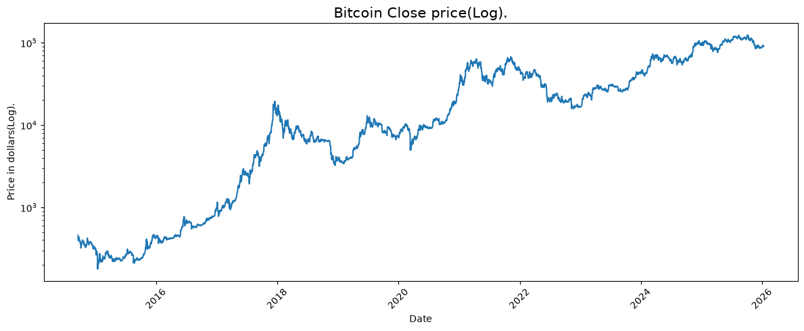
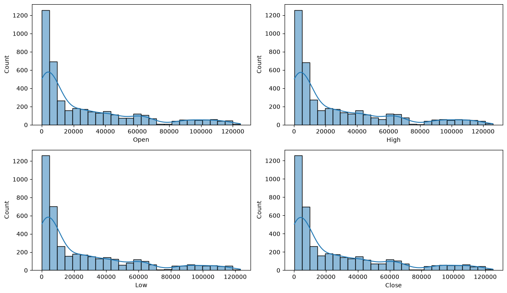
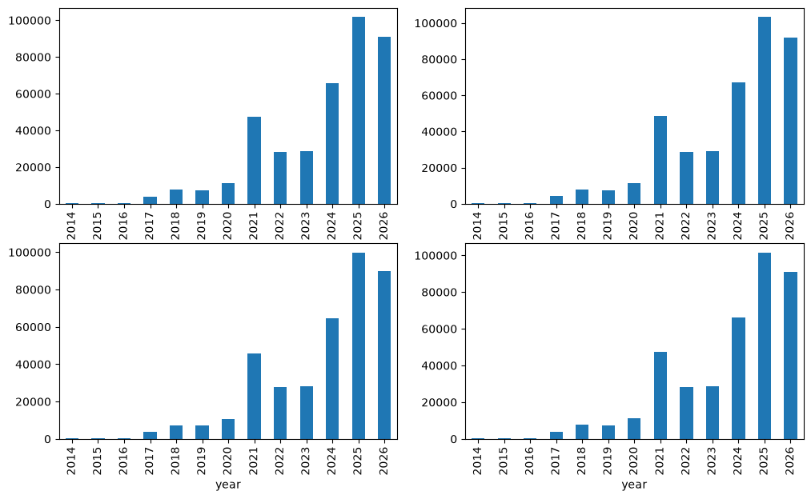
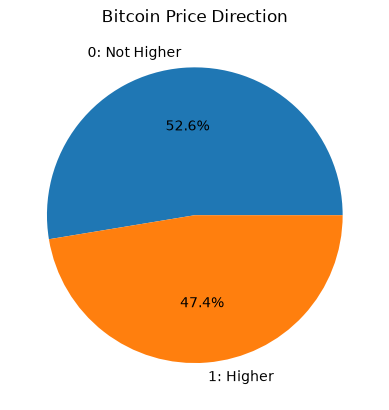

# ₿ Bitcoin Price Direction Prediction using Machine Learning

A Machine Learning project that predicts whether Bitcoin's next closing price will increase using Logistic Regression, Decision Tree, and K-Nearest Neighbors (KNN), with data visualization, feature engineering, and model evaluation.


## Overview

This project analyzes historical Bitcoin price data and uses Machine Learning classification algorithms to predict the direction of the next closing price.

The project uses a dataset containing Bitcoin's opening, highest, lowest, and closing prices. Data visualization and feature engineering are performed to explore price movements and prepare the input features.

Three Machine Learning models are trained and evaluated:

* Logistic Regression
* Decision Tree
* K-Nearest Neighbors (KNN)

The models are evaluated using **ROC-AUC**, which measures their ability to distinguish between upward and non-upward price movements.


## Features

* Bitcoin historical price analysis
* Closing-price visualization using a logarithmic scale
* Price distribution visualization
* Yearly average price analysis
* Target distribution visualization
* Date-based feature extraction
* Feature engineering
* Min-Max-free standardization using `StandardScaler`
* Chronological train/validation split
* Logistic Regression classification
* Decision Tree classification
* K-Nearest Neighbors classification
* ROC-AUC evaluation
* Model performance comparison


## Technologies Used

* Python
* Pandas
* NumPy
* Matplotlib
* Seaborn
* Scikit-learn


## Dataset

The project uses the following dataset:

```text
bitcoin.csv
```

The dataset contains historical Bitcoin price information, including the following features:

| Feature | Description             |
| ------- | ----------------------- |
| `Date`  | Date of the observation |
| `Open`  | Opening price           |
| `High`  | Highest price           |
| `Low`   | Lowest price            |
| `Close` | Closing price           |

The project assumes the dataset is already ordered chronologically, from oldest to newest.

The target variable is:

```text
target
```

It represents the direction of the next closing price:

```text
1 → Next closing price is higher
0 → Next closing price is not higher
```

The goal is to predict price direction rather than the exact future price in dollars.


## Data Preprocessing

Several preprocessing steps are performed before training the models.

### Date Feature Extraction

The `Date` column is used to extract year, month, and day.

```python
splitted = df['Date'].str.split('-', expand=True)

df['year'] = splitted[0].astype('int')
df['month'] = splitted[1].astype('int')
df['day'] = splitted[2].astype('int')
```

These features allow the project to analyze price information over time.

### Feature Engineering

Two additional features are created using the daily prices:

```python
df['open-close'] = df['Open'] - df['Close']
df['low-high'] = df['Low'] - df['High']
```

An additional feature identifies actual quarter-end dates:

```python
df['is_quarter_end'] = (
    pd.to_datetime(df['Date']).dt.is_quarter_end.astype(int)
)
```

### Target Creation

The target is created by comparing the current closing price with the next available closing price.

```python
df['target'] = np.where(
    df['Close'].shift(-1) > df['Close'], 1, 0
)
```

The final row is removed because its next closing price is not available.

### Feature Selection

Three engineered features are used to train the models:

```python
features = df[
    ['open-close', 'low-high', 'is_quarter_end']
]

target = df['target']
```

### Train/Validation Split

The dataset is divided chronologically:

```text
85% → Training data
15% → Validation data
```

Earlier observations are used for training, while later observations are used for validation. This helps evaluate how the models perform on a later time period.

A one-row gap is left at the split boundary because each target depends on the following day's closing price.


### Feature Scaling

`StandardScaler` is used to standardize the input features.

The scaler is fitted only on the training data and then applied to the validation data.

This prevents information from the validation period from influencing the scaling parameters.


## Data Visualization

The project includes several visualizations to explore Bitcoin price behavior.

### Bitcoin Closing Price

A line plot displays the historical closing price over time using a logarithmic vertical axis.

The logarithmic scale helps visualize substantial price changes across different price levels.

<p align="center">
  
</p>

### Price Distribution

Histograms with density curves are used to explore the distributions of the opening, highest, lowest, and closing prices.

<p align="center">
  
</p>

### Yearly Average Prices

The average opening, highest, lowest, and closing prices are grouped by year and visualized using bar charts.

<p align="center">
  
</p>

### Target Distribution

A pie chart illustrates the proportion of observations where the next closing price increases and where it does not increase.

<p align="center">
  
</p>


## Machine Learning Workflow

The project follows the workflow below:

```text
Bitcoin Dataset
       ↓
Data Exploration
       ↓
Price Visualization
       ↓
Date Feature Extraction
       ↓
Feature Engineering
       ↓
Create Target Variable
       ↓
Select Input Features
       ↓
Chronological Train/Validation Split
       ↓
Standardize Features
       ↓
Train Machine Learning Models
       ↓
Generate Predictions
       ↓
Evaluate ROC-AUC
       ↓
Compare Model Performance
```


## Models

Three Machine Learning classification algorithms are used in this project.

### 1. Logistic Regression

Logistic Regression is used to classify whether the next closing price will be higher than the current closing price.

```python
LogisticRegression(max_iter=10000)
```

The model estimates the probability of the next closing price increasing.

### 2. Decision Tree

A Decision Tree classifier learns decision rules from the engineered features to predict the direction of the next closing price.

```python
DecisionTreeClassifier()
```

The model can learn nonlinear relationships between the input features and the target.

### 3. K-Nearest Neighbors (KNN)

K-Nearest Neighbors classifies price direction based on nearby samples in the training data.

```python
KNeighborsClassifier()
```

The input features are standardized before training so that their scales are more comparable for distance-based classification.


## Model Training

The three models are trained using the same training dataset.

```python
models = [
    LogisticRegression(max_iter=10000),
    DecisionTreeClassifier(),
    KNeighborsClassifier()
]

for i in range(3):
    models[i].fit(X_train, Y_train)
```

After training, each model produces predictions and probability estimates for the training and validation datasets.


## Evaluation

The models are evaluated using **ROC-AUC (Area Under the Receiver Operating Characteristic Curve)**.

ROC-AUC evaluates how well a classifier distinguishes between the two target classes using predicted probabilities.

```python
metrics.roc_auc_score(
    Y_valid,
    models[i].predict_proba(X_valid)[:, 1]
)
```

Two ROC-AUC scores are calculated for each model:

* **Training ROC-AUC** — evaluates performance on the training data.
* **Validation ROC-AUC** — evaluates performance on the later validation period.

### Example Output

```text
============================================================
LogisticRegression(max_iter=10000)
Training ROC-AUC:   X.XXXX
Validation ROC-AUC: X.XXXX

DecisionTreeClassifier()
Training ROC-AUC:   X.XXXX
Validation ROC-AUC: X.XXXX

KNeighborsClassifier()
Training ROC-AUC:   X.XXXX
Validation ROC-AUC: X.XXXX
```

The exact results depend on the dataset and the selected model parameters.


## Project Structure

```text
Bitcoin-Price-Direction-Prediction/
│
├── screenshots/
│   ├── bitcoin_close_log.png
│   ├── price_distributions.png
│   ├── yearly_average_prices.png
│   └── target_distribution.png
│
├── bitcoin.csv
├── bitcoin_prediction.ipynb
├── requirements.txt
├── LICENSE
└── README.md
```


## Installation

Install the required Python libraries using:

```bash
pip install numpy pandas matplotlib seaborn scikit-learn
```

You can also install the dependencies from the requirements file:

```bash
pip install -r requirements.txt
```


## How to Run

1. Make sure Python is installed.
2. Place `bitcoin.csv` in the project directory.
3. Install the required libraries.
4. Run the Python script:

```bash
python bitcoin_prediction.ipynb
```

The program will display the price visualizations, train the three classification models, and print their training and validation ROC-AUC scores.


## Author

**Mohammad Reza Bakhshandeh**

Electrical Engineering (Electronics) Graduate

Interested in Python Development, Machine Learning, Computer Vision, Artificial Intelligence, and Data Science.

