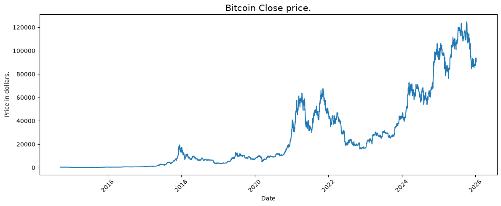

# ₿ Bitcoin Price Direction Prediction using Machine Learning

A Machine Learning project that predicts whether Bitcoin's next closing price will increase using Logistic Regression, Decision Tree, K-Nearest Neighbors (KNN), Support Vector Machine (SVM), and XGBoost, with data visualization, feature engineering, and model performance comparison.

## Overview

This project analyzes historical Bitcoin price data and uses Machine Learning classification algorithms to predict the direction of the next closing price.

The project explores Bitcoin price movements through data visualization, extracts date-based features, and creates additional features from daily price differences.

Five Machine Learning classification models are trained and evaluated:

- Logistic Regression
- Decision Tree
- K-Nearest Neighbors (KNN)
- Support Vector Machine (SVM)
- XGBoost

The models are evaluated using ROC-AUC, accuracy, precision, recall, and F1-score. Their performance is compared using a results table and a bar chart.

The main implementation is provided as a **Jupyter Notebook**, allowing the code, visualizations, model training, and evaluation results to be explored step by step.


## Features

- Bitcoin historical price analysis
- Closing-price visualization using a logarithmic scale
- Price distribution analysis
- Yearly average price visualization
- Target distribution visualization
- Date-based feature extraction
- Feature engineering
- Feature scaling using `StandardScaler`
- Chronological training and validation split
- Logistic Regression classification
- Decision Tree classification
- K-Nearest Neighbors classification
- Support Vector Machine classification
- XGBoost classification
- ROC-AUC evaluation
- Accuracy, precision, recall, and F1-score evaluation
- Model comparison table
- Model comparison bar chart with numerical labels


## Technologies Used

- Python
- Pandas
- NumPy
- Matplotlib
- Seaborn
- Scikit-learn
- XGBoost
- Jupyter Notebook


## Dataset

The project uses the following dataset:

```text
bitcoin (1).csv
```

The dataset contains historical Bitcoin price information, including:

| Feature | Description |
|---|---|
| `Date` | Date of the observation |
| `Open` | Opening price |
| `High` | Highest price |
| `Low` | Lowest price |
| `Close` | Closing price |

The dataset is expected to be ordered chronologically, from oldest to newest, for the time-based validation approach used in the project.

The target variable is:

```text
target
```

It represents the direction of the next closing price:

```text
1 → Next closing price is higher
0 → Next closing price is not higher
```

The project predicts **price direction rather than the exact future Bitcoin price in dollars**.


## Data Preprocessing

Several preprocessing and feature engineering steps are performed before training the models.

### Date Feature Extraction

The `Date` column is used to extract year, month, and day information.

```python
splitted = df['Date'].str.split('-', expand=True)

df['year'] = splitted[0].astype('int')
df['month'] = splitted[1].astype('int')
df['day'] = splitted[2].astype('int')
```

These features can be used to analyze historical price patterns over time.

### Feature Engineering

Two additional features are created using the daily price information:

```python
df['open-close'] = df['Open'] - df['Close']
df['low-high'] = df['Low'] - df['High']
```

The project also creates an `is_quarter_end` feature to identify actual calendar quarter-end dates.

```python
df['is_quarter_end'] = (
    pd.to_datetime(df['Date']).dt.is_quarter_end.astype(int)
)
```

### Target Creation

The target is created by comparing each day's closing price with the following day's closing price.

```python
df['target'] = np.where(
    df['Close'].shift(-1) > df['Close'], 1, 0
)
```

The final row is removed because its next closing price is unavailable, meaning its target cannot be determined.

### Feature Selection

Three engineered features are selected for model training:

```python
features = df[
    ['open-close', 'low-high', 'is_quarter_end']
]

target = df['target']
```

### Chronological Train/Validation Split

The dataset is divided into training and validation sets based on time:

```text
85% → Training data
15% → Validation data
```

Earlier observations are used for training, while later observations are reserved for validation.

This approach is more appropriate for estimating future-period performance than randomly shuffling historical observations.

A one-row gap is left at the split boundary so that the last training target does not depend on the first validation day's closing price.

### Feature Scaling

`StandardScaler` is used to standardize the selected features.

The scaler is fitted only on the training data and then applied to the validation data.

This prevents information from the validation period from influencing the scaling parameters.


## Data Visualization

The project includes several visualizations to explore Bitcoin price behavior.

### Bitcoin Closing Price

A line plot displays the historical closing price over time using a logarithmic vertical axis.

<p align="center">
  
</p>

The logarithmic scale helps visualize substantial price changes across different price levels.

<p align="center">
  
</p>


### Price Distribution

Histograms with density curves are used to explore the distributions of the opening, highest, lowest, and closing prices.

<p align="center">
  
</p>

### Yearly Average Prices

The average opening, highest, lowest, and closing prices are grouped by year and visualized using bar charts.

<p align="center">
  
</p>

### Target Distribution

A pie chart illustrates the proportion of observations where the next closing price increases and where it does not increase.

<p align="center">
  
</p>


## Machine Learning Workflow

The project follows the workflow below:

```text
Bitcoin Dataset
       ↓
Data Exploration
       ↓
Price Visualization
       ↓
Date Feature Extraction
       ↓
Feature Engineering
       ↓
Create Target Variable
       ↓
Select Input Features
       ↓
Chronological Train/Validation Split
       ↓
Standardize Features
       ↓
Train Machine Learning Models
       ↓
Generate Predictions
       ↓
Evaluate ROC-AUC
       ↓
Compare Model Performance
```


## Models

Three Machine Learning classification algorithms are used in this project.

### 1. Logistic Regression

Logistic Regression is used to classify whether the next closing price will be higher than the current closing price.

```python
LogisticRegression(max_iter=10000)
```

The model estimates the probability of the next closing price increasing.

### 2. Decision Tree

A Decision Tree classifier learns decision rules from the engineered features to predict the direction of the next closing price.

```python
DecisionTreeClassifier()
```

The model can learn nonlinear relationships between the input features and the target.

### 3. K-Nearest Neighbors (KNN)

K-Nearest Neighbors classifies price direction based on nearby samples in the training data.

```python
KNeighborsClassifier()
```

The input features are standardized before training so that their scales are more comparable for distance-based classification.


## Model Training

The three models are trained using the same training dataset.

```python
models = [
    LogisticRegression(max_iter=10000),
    DecisionTreeClassifier(),
    KNeighborsClassifier()
]

for i in range(3):
    models[i].fit(X_train, Y_train)
```

After training, each model produces predictions and probability estimates for the training and validation datasets.


## Evaluation

The models are evaluated using **ROC-AUC (Area Under the Receiver Operating Characteristic Curve)**.

ROC-AUC evaluates how well a classifier distinguishes between the two target classes using predicted probabilities.

```python
metrics.roc_auc_score(
    Y_valid,
    models[i].predict_proba(X_valid)[:, 1]
)
```

Two ROC-AUC scores are calculated for each model:

* **Training ROC-AUC** — evaluates performance on the training data.
* **Validation ROC-AUC** — evaluates performance on the later validation period.

### Example Output

```text
============================================================
LogisticRegression(max_iter=10000)
Training ROC-AUC:   X.XXXX
Validation ROC-AUC: X.XXXX

DecisionTreeClassifier()
Training ROC-AUC:   X.XXXX
Validation ROC-AUC: X.XXXX

KNeighborsClassifier()
Training ROC-AUC:   X.XXXX
Validation ROC-AUC: X.XXXX
```

The exact results depend on the dataset and the selected model parameters.


## Project Structure

```text
Bitcoin-Price-Direction-Prediction/
│
├── screenshots/
│   ├── bitcoin_close_log.png
│   ├── price_distributions.png
│   ├── yearly_average_prices.png
│   └── target_distribution.png
│
├── bitcoin.csv
├── bitcoin_prediction.ipynb
├── requirements.txt
├── LICENSE
└── README.md
```


## Installation

Install the required libraries using:

```bash
pip install numpy pandas matplotlib seaborn scikit-learn xgboost jupyter
```

You can also install all dependencies using:

```bash
pip install -r requirements.txt
```


## How to Run

1. Make sure Python is installed.
2. Place `bitcoin.csv` in the project directory.
3. Install the required libraries.
4. Open Jupyter Notebook:

```bash
jupyter notebook
```

5. Open `bitcoin_prediction.ipynb`.
6. Run the notebook cells from top to bottom.

The notebook will display the price visualizations, prepare the features, train the five classifiers, calculate the evaluation metrics, and compare the results using a table and a bar chart.


## Requirements

The main dependencies are:

```text
numpy
pandas
matplotlib
seaborn
scikit-learn
xgboost
jupyter
```


## Future Improvements

- Add time-series cross-validation
- Experiment with additional price-based features
- Add rolling returns and volatility indicators
- Tune model hyperparameters
- Compare additional classification algorithms
- Add confusion matrices
- Save and compare results across multiple validation periods
- Compare models against a simple baseline
- Explore backtesting with transaction costs and risk management


## Contributing

Contributions are welcome.

You can improve the feature engineering, add new classification algorithms, improve the evaluation process, or add additional visualizations to the project.


## License

This project is licensed under the **MIT License**.

See the `LICENSE` file for more information.


## Author

**Mohammad Reza Bakhshandeh**

Electrical Engineering (Electronics) Graduate

Interested in Python Development, Machine Learning, Computer Vision, Artificial Intelligence, and Data Science.

